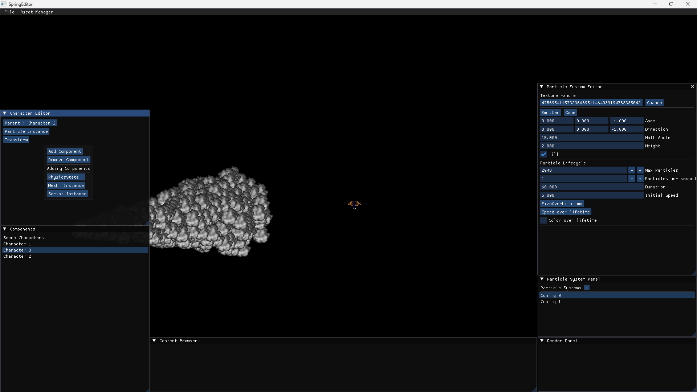

# Spring
A Simple 3D Game Engine
## Renderer
  OpenGL renderer currently supported
## Lua Scripting
  Substantially limited API, meant to be easily extensible
## Physics
  ### Simulation
    Simple Euler integration currently supported
    Runge-Kutta integration planned for future
  ### Colliders
    AABB supported
    more planned for future
  ### Broad Phase Collision Detection
    Bounding Volume Hierarchy
    Z-order curve sorting
# Resource and Asset Management
Resources refer to authored sources of data, this includes:
##### Geometry data (.obj, .mesh)
##### Texture data (.png, .dds)
##### Audio data (.wav)
##### Script data (.lua, .luac)
Loaded resources are assigned a UUID by the asset manager and become assets
# SpringEditor

## Dependencies
* EnTT
* GLM
* stbi_image
* GLEW

## Build System
This project uses Cmake build tools
